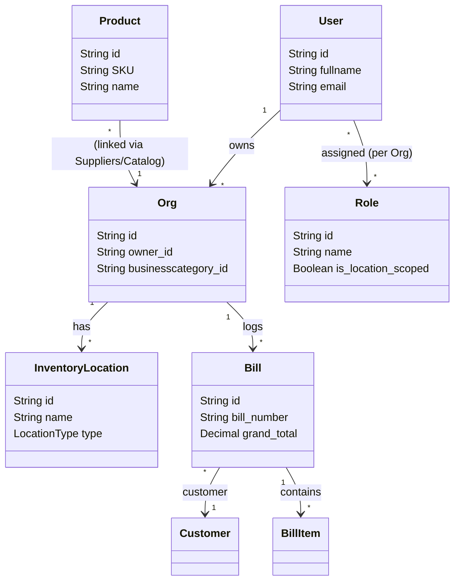

# POS System API Development Report

This report outlines the current implementation status of the **POS System API** (built with NestJS, Prisma, PostgreSQL, Supabase Auth, and Nodemailer).

---

## 📊 Summary of Implementation Progress

| Component | Status | Implementation Details |
| :--- | :---: | :--- |
| **Prisma Schema (Database)** | 🟢 **Complete** | Full relational DB schema with 32 models covering POS business operations (Users, Orgs, Products, Inventory, Purchase Orders, Suppliers, Customers, Loyalty, Billing). |
| **Authentication Module** | 🟢 **Complete** | SUPABASE integrated. Fully implements signup, login, forgot password, reset password, along with `JwtStrategy` and route guarding. |
| **Users Module** | 🟢 **Complete** | Database integration (Prisma CRUD operations) for User registration, lookup, modification, and deletion. |
| **Roles & Permissions** | 🟢 **Complete** | Full RBAC system: Custom Roles, Resource-specific Permissions, dynamic assignment of roles to users per organization, and `PermissionsGuard` for authorization. |
| **Organizations Module** | 🟢 **Complete** | Org CRUD, owner initialization, and member invitation workflow (automates new user auth signup in Supabase, assigns default roles/locations, and triggers invitation emails). |
| **Mail Module** | 🟢 **Complete** | Nodemailer integration supporting invitation and welcome-back emails. Falls back to console-logging (mock) if SMTP configs are not provided. |
| **Business Modules** | 🟡 **In Progress** | **5 modules** fully implemented (Brands, Categories, Products & Pricing, Inventory Locations, Suppliers). **5 modules** are still stubs (Discounts, Purchase Orders, Customers, Loyalty, Bills). |

---

## 🗄️ Database Schema Design

The Prisma schema ([schema.prisma](file:///c:/Users/valal/Documents/Development/GitHub/POSSystem-API/possystem-api/prisma/schema.prisma)) is highly complete and models the following entities:

### Model Groupings:
1. **User & Access Control**: `User`, `Role`, `Permission`, `RolePermission`, `UserRole`, `UserLocation`
2. **Organization**: `Org`, `BusinessCategory`
3. **Product Catalog**: `ProductCategory`, `Brand`, `Product`, `ProductPrice`
4. **Discounts**: `Discount`, `ProductDiscount`, `CategoryDiscount`
5. **Inventory & Suppliers**: `InventoryLocation`, `Supplier`, `PurchaseOrder`, `PurchaseOrderItem`, `StockBatch`, `InventoryStock`, `InventoryTransaction`
6. **Financial Credits**: `SupplierCreditAccount`, `SupplierCreditTransaction`, `CustomerCreditAccount`, `CustomerCreditTransaction`
7. **Customer & Loyalty**: `Customer`, `CustomerLoyaltyTransaction`, `LoyaltyProgramConfig`
8. **Billing & Sales**: `Bill`, `BillItem`, `BillPayment`

---

## 🛠️ Status of Modules & Controllers

### 1. Fully Implemented Modules
*   **[Auth Module](file:///c:/Users/valal/Documents/Development/GitHub/POSSystem-API/possystem-api/src/auth)**: Features controllers/routes for registration (`/auth/register`), login (`/auth/login`), forgot password, reset password. Uses Supabase GoTrue under the hood. Includes a `PermissionsGuard` and `@Permissions()` decorator.
*   **[Users Module](file:///c:/Users/valal/Documents/Development/GitHub/POSSystem-API/possystem-api/src/users)**: Exposes endpoints for managing user profiles (CRUD) bound to database tables.
*   **[Roles Module](file:///c:/Users/valal/Documents/Development/GitHub/POSSystem-API/possystem-api/src/roles)**: Endpoints to CRUD roles/permissions and assign/unassign users to roles per organization (`/roles/assign/:orgId/:userId`, `/roles/user-roles/:orgId/:userId`).
*   **[Orgs Module](file:///c:/Users/valal/Documents/Development/GitHub/POSSystem-API/possystem-api/src/orgs)**: Features organization CRUD. Also includes the member invitation endpoint (`/orgs/:id/members`), which checks if the invited email exists, registers new users in Supabase, maps roles/locations, and sends notifications.
*   **[Mail Module](file:///c:/Users/valal/Documents/Development/GitHub/POSSystem-API/possystem-api/src/mail)**: Contains production SMTP transporter setups and mocks for sending templates.
*   **[Brands Module](file:///c:/Users/valal/Documents/Development/GitHub/POSSystem-API/possystem-api/src/brands)**: Exposes CRUD endpoints for product brands. Full Prisma integration and dependency checks.
*   **[Categories Module](file:///c:/Users/valal/Documents/Development/GitHub/POSSystem-API/possystem-api/src/categories)**: ProductCategory CRUD. Implements self-referencing tree levels, recursive updates for child levels, and circular reference checks.
*   **[Products Module](file:///c:/Users/valal/Documents/Development/GitHub/POSSystem-API/possystem-api/src/products)**: Product catalog CRUD. Auto-generates unique SKUs and barcodes. Implements product prices CRUD and default price enforcement rules (ensuring exactly one active default price per product).
*   **[Inventory Module](file:///c:/Users/valal/Documents/Development/GitHub/POSSystem-API/possystem-api/src/inventory)**: InventoryLocation CRUD covering branches, warehouses, and docks. Includes UserLocation assignment APIs (`/inventory/:locationId/users/:userId`) and lookup routes.
*   **[Suppliers Module](file:///c:/Users/valal/Documents/Development/GitHub/POSSystem-API/possystem-api/src/suppliers)**: Database-backed Supplier CRUD. Restricts deletion if linked to active products, batches, or POs. Exposes supplier products lookup.

### 2. Placeholder Modules (CLI CRUD Stubs)
These modules exist and have standard controllers/routes defined, but their **services** currently return mock strings (e.g. `This action adds a new customer`). They need database queries via the `PrismaService`:
*   **Discounts Module** (`/discounts`)
*   **Purchase Orders Module** (`/purchase-orders`)
*   **Customers Module** (`/customers`)
*   **Loyalty Module** (`/loyalty`)
*   **Bills Module** (`/bills`)

---

